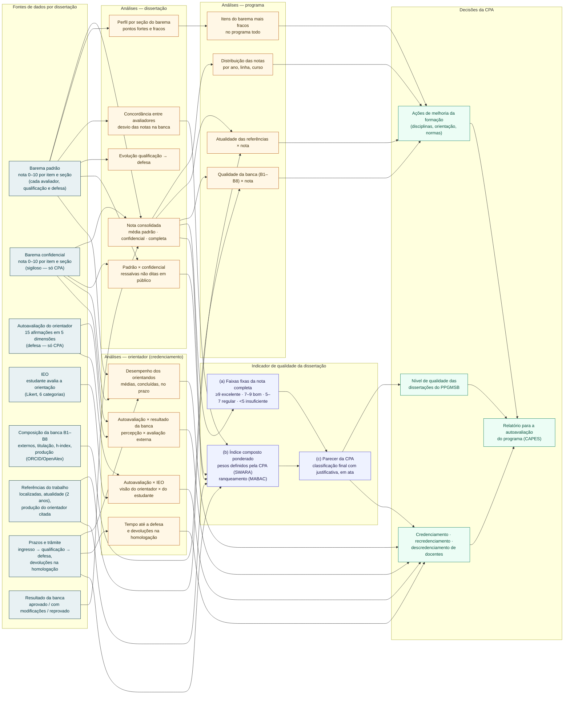

# CPA — análises da qualidade das dissertações (rascunho para discussão)

Diagrama editável: cada caixa é uma linha `ID["texto"]`; cada seta é `ORIGEM --> DESTINO`.
Para remover uma análise, apague a linha da caixa e as setas que usam o ID dela; para incluir, crie uma caixa nova e ligue com setas.
Visualização: extensão "Markdown Preview Mermaid Support" no VS Code, ou cole o bloco em https://mermaid.live.

## Pontos em aberto (para a discussão)

- [ ] Qual caminho para o indicador: (a), (b), (c) ou combinação (proposta: b + c).
- [ ] Se (b): quais componentes entram no índice e quem define os pesos.
- [ ] Nas notas confidenciais, a CPA vê o nome do avaliador ao lado da nota?
- [ ] Período de análise: por ano, por quadriênio CAPES, por turma de ingresso?
- [ ] Membro externo da CPA: como ganha acesso (convite por e-mail, cadastro pela Secretaria)?
